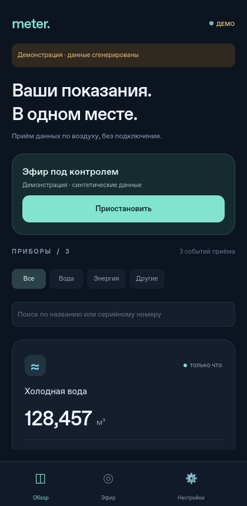

# CodApkMeter

Приложение на **Qt 6 / C++17 / QML** для Android: слушает Bluetooth LE advertising без сопряжения и прямого подключения, расшифровывает данные и показывает показания приборов учёта. Интерфейс адаптируется к телефону и настольному окну.

<p></p>

## Что реализовано

- Обзор приборов: поиск, фильтры, показание, заряд батареи, RSSI, давность приёма.
- Карточка прибора: все декодированные поля, история последних 80 изменений, переименование, установка и удаление ключа.
- Пассивный в смысле отсутствия GATT-соединения приём Manufacturer Data и Service Data через Qt Bluetooth. ОС может выполнять активное BLE-сканирование со scan request.
- Протоколы задаются разработчиком в исходниках и включаются в APK при сборке. В пользовательском интерфейсе редактора, импорта и других способов добавления протоколов нет. Для разработчика доступен отдельный настольный `protocol_tool`.
- AES-128-CCM с проверкой тега, AES-128-CTR, AES-128-CBC и открытые данные. Криптография — Mbed TLS 3.6.5, архив закреплён SHA-256 в CMake.
- Хранение реальных показаний локально; экспорт JSON без ключей. На Android ключи шифруются неэкспортируемым ключом Android Keystore; резервное копирование приложения отключено.
- Деморежим с тремя виртуальными приборами и настоящим проходом через AES-CCM декодер. На настольной платформе ключи реальных приборов сохраняются только в памяти сеанса.

**Реальные модели ещё не подключены:** документации и образцов пакетов пока нет. Встроенные Aqua/Volt — учебные форматы. Для конкретного счётчика потребуются описание пакета и его ключ. Приложение не подбирает ключи и не определяет произвольное шифрование автоматически.

Подробная инструкция для чистого компьютера: **[открыть, изменить и собрать APK в Qt Creator](docs/BUILD_ANDROID.md)** — установка Windows/Linux, необходимые программы, сборка и установка на телефон.

## Быстрый запуск на компьютере

Нужны CMake ≥ 3.22, C++17-компилятор, Qt ≥ 6.8 с Quick, Quick Controls 2, Bluetooth и Qt Test. Для первоначальной загрузки Mbed TLS нужен доступ к GitHub.

```bash
cmake -S . -B build -G Ninja -DCMAKE_BUILD_TYPE=Debug \
  -DCMAKE_PREFIX_PATH=/path/to/Qt/6.8.3/gcc_64
cmake --build build --target codapkmeter protocol_tests catalog_tests backend_tests --parallel 4
ctest --test-dir build --output-on-failure
./build/codapkmeter --demo
# Телефонный размер окна:
./build/codapkmeter --demo --mobile
```

На Linux реальное сканирование требует доступного BlueZ/D-Bus и BLE-адаптера. Для демонстрации Bluetooth не нужен.

### В этой облачной среде

```bash
bash scripts/bootstrap-cloud.sh
source scripts/cloud-env.sh
QT_QPA_PLATFORM=offscreen QT_QUICK_BACKEND=software \
  ./build/codapkmeter --demo --mobile --smoke-test
```

Bootstrap предназначен для Debian 13 и устанавливает инструменты в `/workspace`, не меняя системные каталоги. Для окна нужен графический сеанс; `offscreen` используется для проверки без дисплея. Каждая облачная задача уже изолирована: используйте существующий checkout, отдельный Git worktree не требуется.

Android toolchain и APK в этой среде можно подготовить и пересобрать так:

```bash
bash scripts/bootstrap-android-cloud.sh
# После подготовки — только повторная сборка:
python3 scripts/build-android-cloud.py
```

Скрипты используют предоставленный средой HTTPS-прокси, сохраняют проверку TLS и контрольных сумм и размещают Gradle/SDK/JDK-кэши в `/workspace`. Первичная установка скачивает Qt и Android SDK/NDK; для установленных SDK выполняется стандартное принятие SDK-лицензий. Для ручной локальной сборки используйте обычные инструкции ниже.

## Сборка Android APK

Рекомендуемый набор: Qt **6.8.3 Android arm64-v8a**, соответствующий Qt Desktop для инструментов хоста, Qt Connectivity, Android SDK Platform **35**, Build Tools **35.0.0**, NDK **27.2.12479018**, JDK **17** (в облаке также проверяется JDK 21), CMake и Ninja. Минимальная версия приложения — Android **8.0 / API 26**.

Откройте CMakeLists.txt в Qt Creator, выберите Android arm64 kit и соберите Debug. Либо выполните:

```bash
export JAVA_HOME=/path/to/jdk
export ANDROID_HOME=/path/to/android-sdk
export PATH="$JAVA_HOME/bin:$PATH"
/path/to/Qt/6.8.3/android_arm64_v8a/bin/qt-cmake -S . -B build-android -G Ninja \
  -DCMAKE_BUILD_TYPE=Debug -DBUILD_TESTING=OFF \
  -DANDROID_ABI=arm64-v8a -DANDROID_PLATFORM=android-26 \
  -DANDROID_SDK_ROOT="$ANDROID_HOME" \
  -DANDROID_NDK_ROOT="$ANDROID_HOME/ndk/27.2.12479018" \
  -DQT_HOST_PATH=/path/to/Qt/6.8.3/gcc_64 \
  -DANDROID_SUPPORT_FLEXIBLE_PAGE_SIZES=ON
cmake --build build-android --target apk --parallel 4
```

Debug APK появляется в `build-android/android-build/build/outputs/apk/debug/`. Он предназначен для установки и проверки, не для публикации в магазине. Для публикации нужна собственная release-подпись; ключ подписи в репозиторий не включается.

В `.github/workflows/build.yml` подготовлены настольные тесты и Android arm64 сборка с выгрузкой debug APK в артефакты GitHub Actions. Workflow запускается после отправки файлов в GitHub; наличие YAML само по себе не означает успешный запуск CI.

## Первый запуск на телефоне

1. Включите Bluetooth и нажмите «Начать приём». Разрешите доступ к устройствам поблизости. На Android 8–11 также нужны разрешение и включённая геолокация.
2. Откройте «Эфир», чтобы увидеть Manufacturer/Service Data. Неизвестные пакеты доступны для копирования.
3. Поддерживаемые форматы определяются встроенным каталогом этой версии приложения. Для новой модели разработчик добавляет описание в исходники, проверяет его и выпускает обновлённый APK.
4. При поступлении подходящего пакета прибор появится в обзоре. Установите его ключ в карточке. Ошибка CCM-подлинности не заменяет последнее успешное показание; время этого показания отображается отдельно.
5. Без прибора можно включить деморежим в настройках. Учебный ключ: `00112233445566778899aabbccddeeff`.

Добавление протокола разработчиком, описание формата и пример пакета: [docs/PROTOCOLS.md](docs/PROTOCOLS.md).

## Ограничения и проверка на устройстве

- Поддерживается **BLE advertising**, а не классический Bluetooth, не GATT notifications, не Bluetooth Mesh и не закрытые радиопротоколы.
- Приём работает при открытом приложении. При сворачивании он приостанавливается, после возврата возобновляется. Фоновый Android-сервис не реализован.
- Qt может объединять повторы advertising и scan response. Счётчик означает события Qt, а не гарантированное количество радиопакетов. `neverForLocation` на Android 12+ может фильтровать некоторые виды beacon-пакетов.
- AES-CTR и AES-CBC **не аутентифицируют данные**. Неверный ключ может дать допустимые числа; для достоверного результата нужен предусмотренный изготовителем MAC/контроль целостности. Автоматическая защита от replay без спецификации счётчика пакетов не реализована.
- Нет поддержки сборки nonce из нескольких несмежных полей, производных ключей, нестандартных CRC/MAC, составных/многофреймовых сообщений. Для таких схем расширяется C++ декодер.
- Лимиты: 200 приборов суммарно, 200 событий эфира, пакет до 1650 байт, описание до 64 КБ, 32 поля.
- Облачные проверки не заменяют испытание на Android: разрешения, Bluetooth, Keystore, выбор файлов, сворачивание и поведение конкретного прибора проверяются на телефоне.

## Структура

| Путь | Назначение |
| --- | --- |
| `src/protocol.*` | Валидация протоколов, чтение полей, криптография |
| `src/backend.*` | Bluetooth, демогенератор, хранилище, экспорт |
| `src/keyvault.*`, `android/src/` | Android Keystore и JNI |
| `qml/` | Пользовательский интерфейс: обзор, эфир, настройки |
| `protocols/` | Два учебных AES-CCM протокола |
| `src/protocolcatalog.*` | Загрузка только скомпилированных ресурсов и проверка каталога |
| `tools/protocol_tool.cpp` | Настольная утилита разработчика, не входит в APK |
| `tests/` | Криптовекторы, каталог, отсутствие пользовательского API, сохранение показаний |

Результаты выполненных проверок: [docs/VALIDATION.md](docs/VALIDATION.md).

Сведения о сторонних компонентах: [THIRD_PARTY_NOTICES.md](THIRD_PARTY_NOTICES.md).
